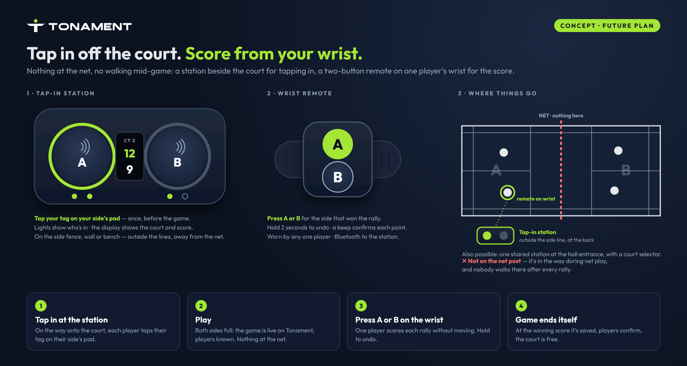

# Future plan: tap-in games with NFC tags, a court-side station and a wrist remote

Status: **planned, not built.** Hardware: a tap-in station beside each court and a wrist remote for scoring (in design).

## The problem
At daily group sessions nobody wants to set up games on a phone: finding
players, picking sides, choosing a court. Any flow that needs an organiser
holding a phone fails. Players should create the game themselves with one
natural action, with phones left in their bags.

## The idea: tap in off the court, score from your wrist

Two parts, so nothing sits at the net and nobody walks anywhere mid-game.

**1. Tap-in station: off the court, used only between games.**
On the side fence, the wall behind the court or the bench: outside the lines,
away from the net. One per court (or one shared station at the hall entrance,
with a court selector). It has two NFC pads, A and B, one per side, a small
display (court and score) and lights for who has tapped in.

- **Tap in.** On the way onto the court, each player taps their tag on their
  side's pad. When both sides are filled (1 v 1 or 2 v 2) the game starts.
- **No tag?** Press your side's pad without tapping: the spot is "open" and
  the player claims it later in the app with one tap. The game never waits.

**2. Scoring: a two-button wrist remote, one per court.**
A small Bluetooth remote (like a camera or presentation remote) in a silicone
wristband or clip, worn by any one player. Paired with that court's station.

- **Score.** Press A or B for the side that won the rally. A beep (and the
  station's display, or the venue TV) confirms it.
- **Undo.** Hold either button for 2 seconds.
- **End.** At the game's finishing score it's saved, the court is free, and
  the players get the result to confirm (as today).

### Why not on the net post
An earlier concept put one box with both pads on the net post. Two problems:
it's in the way during net play (players can hit it), and nobody walks to
the post after every rally. Tapping in happens once, so the station can live
off court; scoring happens every rally, so it has to stay on the player.

### Scoring alternatives
- **Smart end cap:** a tiny button plus the NFC tag in the racket's handle
  cap. The cap knows its owner and side, so a press scores for your side.
  Elegant but custom-made (about Rs 300–600 per cap), and the button must not
  be pressed by accident while playing.
- **Score at the end only:** no per-point scoring; when the game ends, enter
  the final score once on the station (two +/− dials). Same as the existing
  "final score" mode. Lowest effort when live scores don't matter.
- **Not recommended:** a phone listening for "point A" (halls are loud);
  pads on the net post (see above).

## Tags
- A player can link **any number of tags** (several rackets, paddles, a
  wristband). Any of them identifies the same person.
- **Link a tag:** in the app, "My tags → Add". On Android (Chrome Web NFC),
  hold the tag to the phone. On iPhone (no Web NFC), tap the tag on any
  court station within 30 seconds of pressing Add.
- **Unknown tag tapped:** joins the game as "Unknown player"; claimable later.
- **Borrowed racket:** the last tap on a side replaces an earlier one; or the
  tag's owner taps "Not me" on the result, which opens the spot to claim.
- **Lost tag:** "My tags" lists each (name, last used); remove it to disable.
- Each tag can also hold a link (NDEF URL) to the player's Tonament profile,
  so tapping it with any phone opens their page.

## App work (when the hardware is ready)
- Schema: `player_tags` (user, tag UID, label, created, last used, removed);
  stations bound to a group/venue court, wrist remotes paired to stations;
  open spots on games.
- API for the station: authenticated device token; events below.
- "My tags" page; tap-in games; claim / "Not me"; open spots.
- A **phone stand-in for the station and remote** (two big side pads; Web
  NFC on Android) so groups can trial the flow before the hardware exists.

## Station ↔ Tonament messages (draft)
The station authenticates with a per-device token and is bound to a court
(a shared station sends the court with each event). The wrist remote pairs
with the station over Bluetooth; its presses reach Tonament through it.
- `tag` `{ side: "a"|"b", uid: "04A1B2C3D4E5F6", at }` — a tag tapped on a side
- `press` `{ side, at }` — a point from the remote (or, at the station before
  the game starts, an "open spot" on that side)
- `undo` `{ at }` — take back the last point
- `reset` `{ at }` — clear a game that hasn't started
- `pair` `{ remote, at }` — a wrist remote paired with this station
- `court` `{ no }` — the court a shared station is set to
Server replies with the court's state (sides filled, score, game over) so
the station can light up and beep. Events carry a sequence number and are
queued on the device if the connection drops (same idea as offline scoring
today). Connection: open question — Wi-Fi, 4G, or Bluetooth to a phone.

## Parts list and cost

Approximate Indian retail prices (Robu.in, Robocraze, Amazon.in), 2026, for
prototype quantities. Check current prices before ordering.

### Station (one per court): prototype parts

| Part | Suggested module | Qty | Approx. cost (Rs) |
|---|---|---|---|
| Brain (Wi-Fi + Bluetooth) | ESP32-S3 dev board | 1 | 450–700 |
| NFC readers | PN532 (reliable with NTAG and iPhone-friendly tags); RC522 is cheaper at Rs 120–180 each | 2 | 700–900 |
| Score display, readable from the court | MAX7219 8×32 LED matrix | 1 | 300–450 |
| Pad light rings | WS2812B 16-LED ring | 2 | 300–500 |
| "Open spot" buttons (press without a tag) | 60 mm arcade button, mounted beside each pad (metal under a pad blocks NFC) | 2 | 160–300 |
| Beeper | Active buzzer | 1 | 20–40 |
| Power, mains | 5 V 2 A USB adapter + USB-C cable | 1 | 250–400 |
| Power, battery backup (optional) | 2× 18650 cells + holder + charger/boost board | 1 set | 400–600 |
| Enclosure | 3D-printed PETG case with frosted acrylic pad windows | 1 | 500–900 |
| Mount | Fence clamp, velcro straps, cable ties | 1 set | 100–200 |
| Wiring | Perfboard, jumper wires, connectors, screws | 1 set | 200–300 |
| **Station total** | | | **about 3,000–4,700 on mains** (about 3,400–5,300 with the battery backup) |

### Wrist remote (one per court): two routes

**A. Custom (recommended for the prototype).** We control the firmware, it pairs reliably with the station, the battery lasts weeks, and it vibrates to confirm.

| Part | Suggested module | Qty | Approx. cost (Rs) |
|---|---|---|---|
| Brain (Bluetooth LE, low power) | Seeed XIAO nRF52840 (or XIAO ESP32-C3 at Rs 500–700, with shorter battery life) | 1 | 900–1,200 |
| Buttons A / B | 12 mm tactile buttons with large caps | 2 | 30–60 |
| Battery | 150–300 mAh LiPo (the XIAO charges it over USB-C) | 1 | 200–300 |
| Vibration motor (confirms each point) | Coin vibration motor | 1 | 40–80 |
| Case | 3D-printed TPU/PETG pod | 1 | 200–300 |
| Strap | Silicone watch strap (20 mm) or clip | 1 | 100–200 |
| **Remote total** | | | **about 1,500–2,100** |

**B. Off the shelf (cheapest trial).**
- What: a Bluetooth "selfie" or camera remote, Rs 150–300; or a 2-button presentation clicker, Rs 500–900.
- How: the station connects to it as a Bluetooth keyboard and reads its key presses.
- Downsides: pairing is less reliable, there's no vibration, and some have only one useful button.
- Use: good for proving the idea in week one.

### Player tags
- NTAG213 sticker (plastic handle caps, phone cases): Rs 10–25 each, in packs of 50–100.
- Anti-metal sticker (carbon or metal frames): Rs 40–90.
- Silicone NFC wristband (always on the player): Rs 50–120.

### Totals: example group with 2 courts and 20 players
| Item | Qty | Approx. cost (Rs) |
|---|---|---|
| Stations (on mains) | 2 | 6,000–9,400 |
| Wrist remotes (custom) | 2 | 3,000–4,200 |
| Tags (stickers, with spares) | 25 | 300–600 |
| **Total, prototype** | | **about 9,300–14,200** |
| …with off-the-shelf selfie remotes instead (2 × Rs 150–300) | | about 6,600–10,600 |

One-time tools, if building in-house: a soldering kit (Rs 800–1,500), a multimeter (Rs 500–800), and the 3D printing done by a local service.

### At volume (100+ units, custom PCB): rough parts cost per unit
- **Station:** about Rs 1,200–1,800.
  - Two RC522-class readers on the board, an ESP32-S3 module, an LED matrix, an injection-moulded or batch-printed case.
  - Excludes one-time PCB design and mould costs, typically Rs 50,000–2,00,000 for moulds; batch 3D printing avoids those.
- **Wrist remote:** about Rs 400–700.
  - An nRF52 module, LiPo, motor and a moulded pod.
- **Tags:** about Rs 8–15 each in bulk, and can be printed with the Tonament logo.
- A selling price would sit above these figures; that's for the founder to set.

### Notes for the builder
- **Pad and reader placement:**
  - Put each NFC reader's antenna directly under a 2–3 mm acrylic or plastic window. Nothing metal above it.
  - Keep the arcade button beside the pad, not on top of it.
  - Space the two readers at least 10 cm apart so they don't interfere.
- **Weatherproofing:** for outdoor courts, use an IP54 enclosure and seal the display window.
- **Firmware:** the station acts as the Bluetooth host for the remote; the messages to Tonament are listed above.

## NFC tag facts (for choosing hardware)
- **Chip:** NTAG213/215 (NFC Forum Type 2). Read by every NFC phone,
  including iPhones; cheap; 144/504 bytes of storage. Avoid MIFARE Classic
  (many phones, including iPhones, can't read it; its security is broken).
- **Identity:** every tag has a factory-set, unchangeable 7-byte ID (UID). That
  is what Tonament stores. UIDs can be cloned with special blank tags; fine for
  casual games. If spoofing ever matters (prize leagues), NTAG 424 DNA tags
  produce a fresh signed code on every tap.
- **No battery.** Powered by the reader's field; lasts years; waterproof
  versions (epoxy, silicone) survive sweat.
- **Range:** a deliberate tap, about 1–4 cm. That is a feature here: it can't
  pick up the next court or someone walking past.
- **Metal and carbon:** frames and shafts can block the signal. Put the tag on
  the plastic butt cap of the handle, or use "anti-metal" (on-metal) tags.
- **Write/lock:** tags can store a URL and be write-locked.
- **Prices:** see "Parts list and cost" above.
